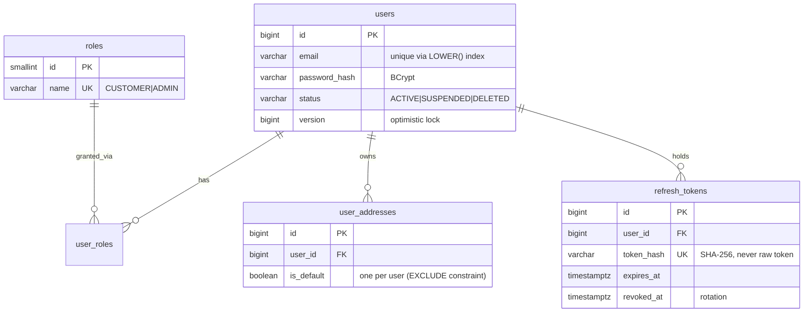
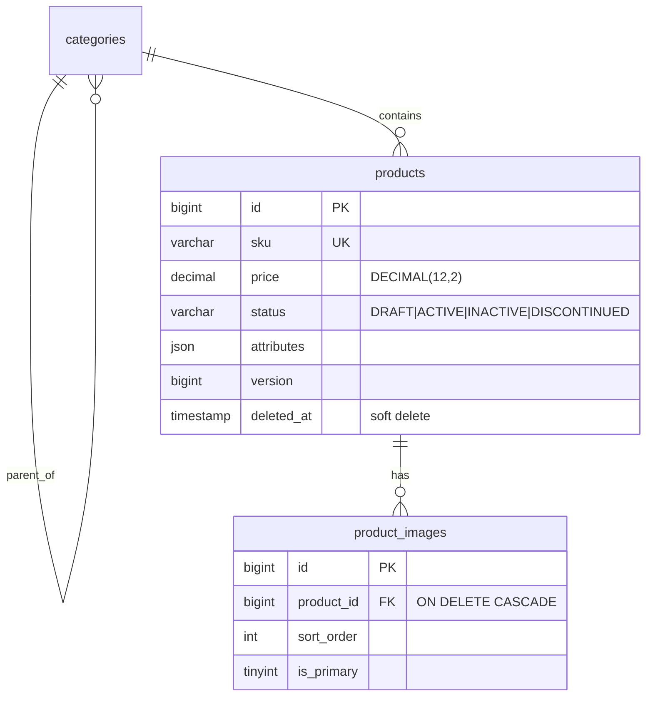
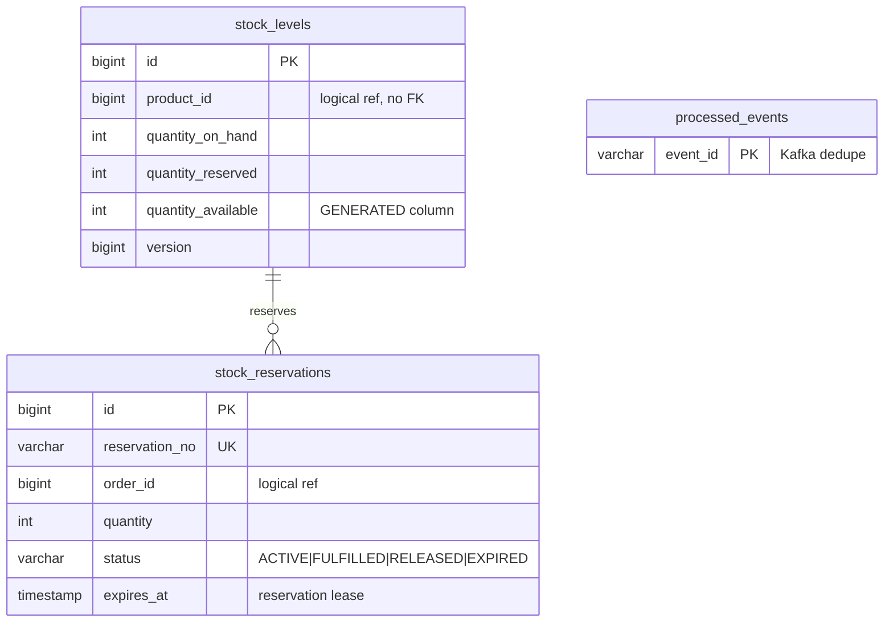
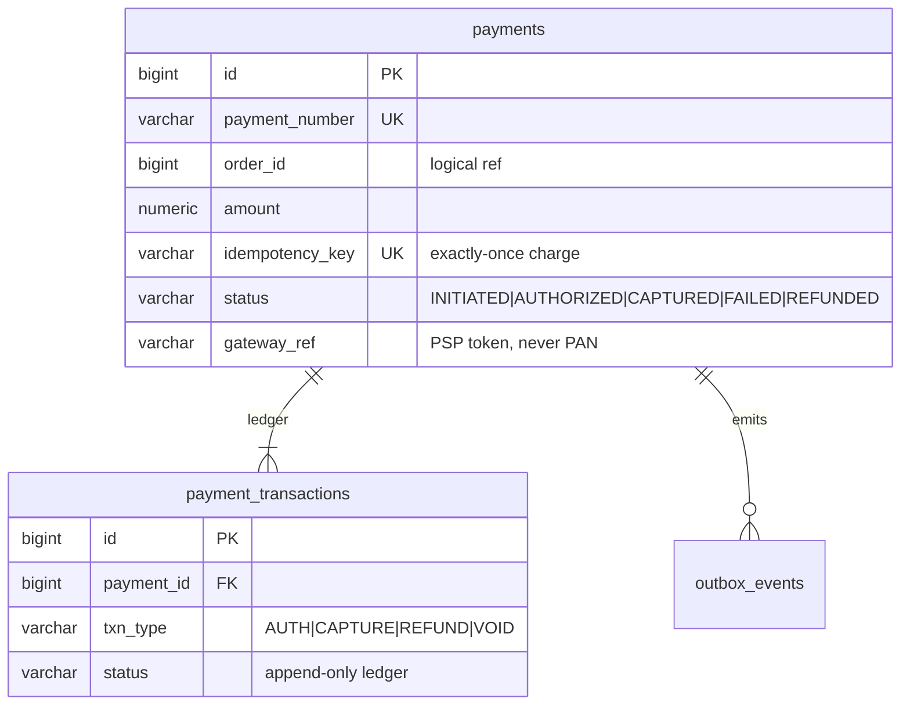

# ShopSphere — Database Design & Schema Documentation

Database-per-service. **No service ever reads another service's database.**
Cross-service references (`customer_id`, `product_id`, `order_id`) are
*logical* — plain BIGINT columns with no FK — resolved via APIs/events.

## Ownership Map

| Database | Engine | Owning service | Tables |
|---|---|---|---|
| `userdb` | PostgreSQL 16 | user-service | users, roles, user_roles, user_addresses, refresh_tokens |
| `productdb` | MySQL 8.4 | product-service | categories, products, product_images |
| `cartdb` | MySQL 8.4 | cart-service | carts, cart_items |
| `inventorydb` | MySQL 8.4 | inventory-service | stock_levels, stock_reservations, processed_events |
| `orderdb` | PostgreSQL 16 | order-service | orders, order_items, outbox_events |
| `paymentdb` | PostgreSQL 16 | payment-service | payments, payment_transactions, outbox_events, processed_events |
| — | none (Kafka + Redis) | notification-service | consumes events only |

## ER Diagrams

### userdb



### productdb



### inventorydb (overselling-critical)



### orderdb

```mermaid
erDiagram
    orders ||--|{ order_items : contains
    orders ||--o{ outbox_events : emits
    orders {
        bigint id PK
        varchar order_number UK "ORD-YYYY-NNNNNN"
        bigint customer_id "logical ref"
        varchar status "PENDING|CONFIRMED|SHIPPED|DELIVERED|CANCELLED|FAILED"
        numeric subtotal, tax_amount, total_amount
        jsonb shipping_address "snapshot"
        varchar saga_state "resumable saga position"
        bigint version
    }
    order_items {
        bigint id PK
        bigint order_id FK
        bigint product_id "logical ref"
        numeric unit_price "snapshot at order time"
    }
    outbox_events {
        uuid id PK
        varchar event_type "order.created etc."
        jsonb payload
        timestamptz published_at "NULL = pending"
        int attempts
    }
```

### paymentdb



## Key Design Decisions

### Normalization
- `order_items`, `product_images`, `user_addresses`, `payment_transactions`
  are separate tables (1:N) — avoids repeating groups, keeps rows narrow,
  allows independent lifecycle (e.g. soft-delete one image).
- `roles`/`user_roles` is a real M:N join table — new roles are data, not DDL.
- Denormalization is **deliberate and documented**: `cart_items` and
  `order_items` snapshot `sku`, `product_name`, `unit_price` because the
  source product can change or be deleted after purchase. Snapshot-at-write
  is the correct trade-off for financial/audit correctness.

### Constraints that carry business rules
| Constraint | Rule enforced |
|---|---|
| `uk_carts_customer` | one active cart per customer |
| `uk_cart_items_cart_product` | product appears once per cart |
| `uk_stock_product_warehouse` | one stock row per product+warehouse |
| `chk_stock_nonneg` | `reserved <= on_hand` at DB level |
| `uk_reservation_order_product_status` | no double-reserve on event replay |
| `uk_payments_idempotency` | no double-charge on retry/replay |
| `uk_users_email_lower` | case-insensitive unique email |
| EXCLUDE constraint on `user_addresses` | max one default address |
| `chk_*_status` | only legal status *values* (transitions are app-level) |

### Indexing strategy
- **Composite** `products(category_id, status, price)` — matches the
  storefront filter+sort query exactly (leftmost-prefix rule).
- **Partial** `outbox_events ... WHERE published_at IS NULL` — the relay's
  poll query stays O(pending), not O(history).
- **Partial** `refresh_tokens ... WHERE revoked_at IS NULL` — only live
  tokens scanned.
- **FULLTEXT** on `products(name, description)` — MySQL native full-text
  search; at larger scale this moves to Elasticsearch/Opensearch.
- **DESC index** on `orders(customer_id, created_at DESC)` — "my orders"
  page.

### Money & time
- `DECIMAL`/`NUMERIC` everywhere money appears — never `FLOAT`/`DOUBLE`.
- `TIMESTAMPTZ` in Postgres (timezone-aware); `TIMESTAMP(6)` in MySQL
  (store UTC, convert at edges). Microsecond precision avoids same-ms
  ordering bugs.

### Concurrency control
- `version` columns → JPA `@Version` optimistic locking on
  `products`, `carts`, `users`, `orders`, `payments`, `stock_levels`.
- Inventory mutations additionally use **pessimistic locking**
  (`SELECT ... FOR UPDATE`) — overselling must be impossible, so we pay the
  contention cost there specifically.

## INTERVIEW EXPLANATION

**Q: Why no FK across services?**
FKs across databases create distributed coupling: you can't delete a product
without checking orders in another DB, backups become inconsistent, and
each service loses deploy independence. Logical references + saga
compensation is the standard answer.

**Q: Why store price snapshots in order_items?**
Prices change. An order is a *historical fact* — it must show what the
customer agreed to pay, not today's catalog price. Same reason invoices
don't re-join to the product table.

**Q: Optimistic vs pessimistic locking — when which?**
Optimistic (`@Version`): low-contention, read-heavy entities — products,
orders. Pessimistic (`FOR UPDATE`): stock reservation, where the check-and-
decrement must be atomic and contention is the whole point. Interviewers
want you to know pessimistic locking kills throughput if used everywhere.

**Q: What is the N+1 problem and how do we avoid it here?**
Lazy `@OneToMany` + per-item access in a loop = N+1 queries. Fixes used in
this project: `JOIN FETCH` in repository queries for order→items,
`@EntityGraph`, or DTO projections. We'll demonstrate in Part 3/8.

**Q: How would this schema change at 100× scale?**
Partition `orders`/`payment_transactions` by month (range partitioning),
move `processed_events` and `outbox_events` to a dedicated messaging store
(Kafka itself or Redis), add read replicas for order history, and archive
cold reservations.
